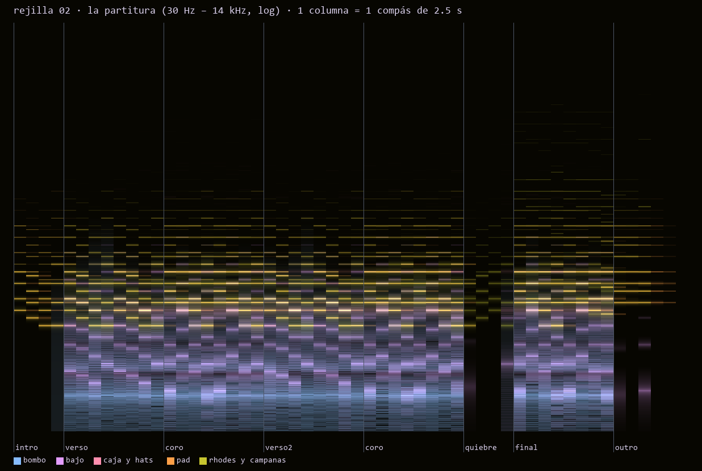
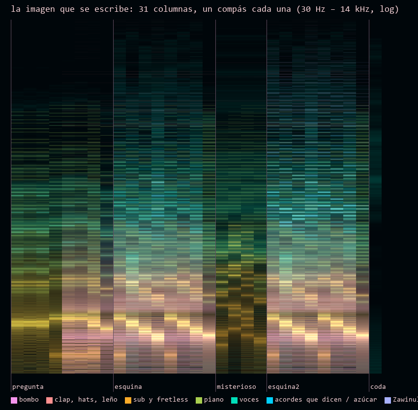
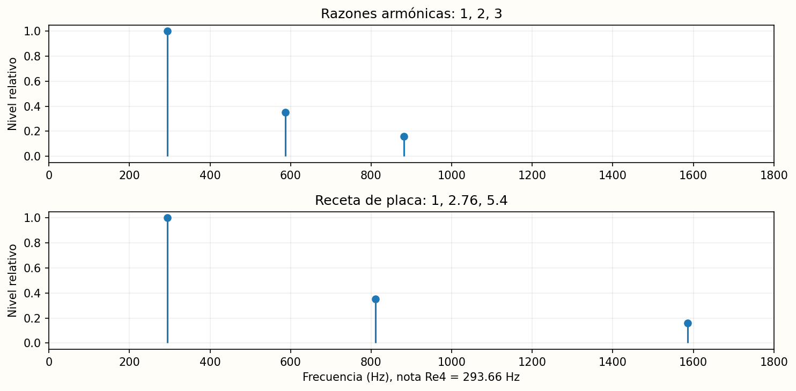
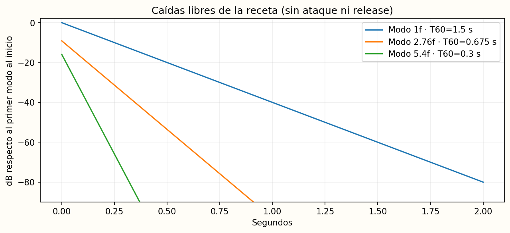
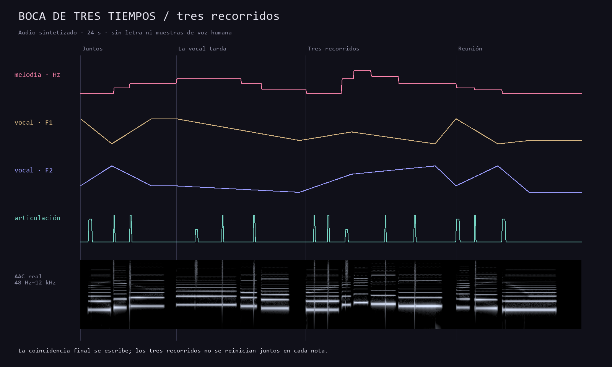

# Rejilla: componer imágenes, diseñar sonidos

Canek Zapata · Taller para músicos · Edición del 20 de octubre de 2026

Este manual supone que ya haces música. Se concentra en traducir una intención musical a notas, resonancias, controles e imágenes, y en producir resultados que otra persona pueda escuchar y reconstruir. No hace falta saber programar para empezar a explorar. La ruta de producción introduce sólo los elementos de Python y terminal que necesitas para los ejercicios.

**La forma principal de uso es conversar con tu asistente:** abre esta carpeta como proyecto, pídele que lea `AGENTS.md` y dile qué quieres hacer. El asistente se encarga de preparar herramientas, escribir la partitura, ejecutar y entregar audio e imágenes. Empieza por `USAR-CON-TU-ASISTENTE.md`, con pedidos listos para copiar. Las instrucciones técnicas de este manual sirven al asistente y como referencia para quien quiera trabajar directamente.

## 1. Elegir una ruta

**Pedirlo en lenguaje natural:** «oye, haz una pieza con una boca que se mueve lento y un bajo que le contesta». Da ese pedido a un asistente con acceso a la carpeta y ejecución de programas. Las instrucciones incluidas le exigen producir los archivos y comprobarlos. Esta ruta usa los mismos motores y ejemplos, sin obligarte a editar código o escribir comandos. El paquete no incluye una IA; funciona como proyecto para tu asistente.

**Explorar:** prepara las dependencias de README.md y ejecuta `python herramientas/servidor.py --abrir`. El secuenciador ofrece 30 timbres Web Audio. El catálogo calcula las demás muestras integradas con Python/Node. Puedes exportar WAV, partitura, PNGs, GIF y receta.

**Producir y modificar:** instala Python y las cuatro bibliotecas indicadas. Abre el taller por su lanzador para elegir un archivo JSON y producir audio e imágenes. El motor Directo suma las resonancias en el tiempo. El motor Rejilla escribe magnitud y fase y usa FFmpeg para convertirlas en sonido. Directo es una comparación pedagógica; no sustituye ni se etiqueta como el motor espectral original.

**Sólo FFmpeg:** sí funciona sin Python. En `ejemplo-ffmpeg/` hay magnitud y fase ya calculadas y dos lanzadores para volverlas a sintetizar. Puedes hacer sonar esa partitura congelada sin Python; editar notas o recalcular los coeficientes requiere un programa que los prepare. FFmpeg no interpreta por sí solo el JSON musical de este taller. [1]

**Doce prototipos:** sus motores son Python con NumPy/SciPy; no necesitan FFmpeg para generar WAV. Sus muestras se calculan desde el catálogo con Python. Mantienen su condición de prototipos: no se promete habla inteligible ni una emulación exacta de instrumentos o aparatos comerciales.

## 2. Qué contiene cada carpeta

`laboratorio.html` es la entrada interactiva. `manual.html` y `manual.pdf` son dos versiones de este texto. `galeria.html` reúne imágenes reales de piezas anteriores, audio y explicaciones. `ejemplos/` contiene las partituras editables; `python/` contiene el productor y la ventana de botones. `biblioteca-de-instrumentos/` es una copia fijada del catálogo, sus fichas, motores y código conservado. `fuentes/rejilla/` conserva el motor original utilizado; `fuentes/doce/` conserva los doce prototipos y sus partituras originales.

Los audios y recetas nuevos van a `renders/` y `salidas/`, ignorados por Git. `imagenes/` conserva las ilustraciones pedagógicas. El censo actual está en `INVENTARIO-INSTRUMENTOS.json`.

El catálogo visible de esta edición suma **330 entradas**: 231 fichas, 34 entradas de código conservado, doce prototipos, 38 ejemplos propios y quince referencias recientes. No se equiparan entradas con instrumentos únicos. Los 30 timbres compatibles con `web.js` se pueden secuenciar en el laboratorio. Los motores propios se escuchan también en `motores-propios.html` y se producen desde sus pedidos JSON con Python y, en los casos JavaScript, Node.js.

`research/rejilla/` y `archivo/` conservan el censo completo de fuentes de las piezas, incluidas sus variantes. `INVENTARIO-REJILLA.json` permite localizar cada archivo por origen y huella. `MOTORES-PROPIOS.md` y los capítulos 18–19 explican Siringua, cinta, convoy, traductor, gargantas, duna, cráteres y el resto de la ampliación.

## 3. Primera sesión, sin instalar nada

Extrae todo el ZIP en una carpeta donde puedas guardar archivos. En Windows: clic derecho, Extraer todo. En Mac: abre el ZIP y mueve la carpeta extraída a Documentos. Abre `EMPIEZA-AQUI.html`, después Laboratorio. Si el sistema no asocia HTML con un navegador, elige Abrir con y selecciona el tuyo.

En el catálogo busca «marimba» y pulsa Escuchar muestra conservada. Después busca «Boca de tres tiempos»: escucha una muestra de su prototipo; el texto distingue la grabación del instrumento que puedes secuenciar directamente. Los botones no piden micrófono, cámara ni acceso a una cuenta. Presiona Detener antes de cambiar de muestra si quieres evitar superposiciones.

En la secuencia, deja Marimba a 100 BPM. Ocho pasos están encendidos. Desactiva algunos y escucha la diferencia de densidad. Cambia los 16 números MIDI para escribir tu melodía; 60 = Do4, 62 = Re4, 69 = La4. El secuenciador tiene 16 semicorcheas, es decir un compás de 4/4. La exportación Python deja un segundo compás para recoger colas: no añade otro compás de notas.

Pulsa Exportar entrega ZIP. Extrae esa segunda carpeta y abre el WAV y sus PNGs. La receta identifica el motor, los parámetros y las huellas. El GIF de onda y espectro muestra dos análisis reales del audio; no finge que sean borradores de composición. Las gráficas son parte de la entrega, no una decoración opcional.

## 4. Instalar el taller en Windows

Usa Python 3.13 de 64 bits desde python.org. Esta edición se probó con Python 3.13 y las versiones exactas de `requirements.txt`; otras versiones requieren su propia comprobación. En el instalador clásico, habilita la opción de agregar Python a PATH si aparece. Si usas el administrador actual de Python, asegúrate de que `py -3.13` selecciona esa versión. Los instaladores y sus opciones cambian: consulta la documentación oficial enlazada al final. [2]

Abre `Preparar-Windows.bat`. El lanzador intenta localizar Python 3.13 y después `python`. La preparación crea `.venv` dentro de la carpeta y descarga NumPy, SciPy, Matplotlib y Pillow. Necesita internet una vez. No descarga FFmpeg ni modifica tu Python global. Espera hasta ver «Listo». Si falla, conserva el mensaje visible y consulta el capítulo de problemas; no hace falta repetir todo a ciegas.

Abre `Taller-Windows.bat`. Elige `ejemplos/01-una-nota.json`, motor Directo y Producir. La ventana muestra el progreso y la carpeta de salida. Cada ejecución crea un nombre nuevo: tus resultados anteriores se conservan. También puedes usar IDLE: abre `python/ventana.py` con IDLE y selecciona Run Module después de preparar las dependencias en el entorno correcto.

FFmpeg es opcional para Directo y los doce prototipos. Para el motor Rejilla, ve a la página oficial de descargas, sigue el enlace de compilaciones para Windows, extrae el paquete y copia únicamente `ffmpeg.exe` a `bin/` de este taller. El programa también acepta un FFmpeg ya disponible en PATH. Debe incluir el filtro `spectrumsynth`. No se distribuyen ejecutables de terceros en este ZIP. [1,3]

## 5. Instalar el taller en Mac

Instala Python 3.13 para macOS desde python.org. El instalador de python.org incluye su propia distribución; no dependas del Python de herramientas del sistema. La documentación oficial explica IDLE, Python Launcher y la instalación. [4]

Los archivos `.command` de un ZIP pueden perder el permiso de ejecución. Si Preparar-Mac.command abre como texto o dice permiso denegado, abre Terminal, escribe `sh ` con un espacio al final, arrastra `Preparar-Mac.command` a esa ventana y presiona Enter. Las comillas o el escape de espacios los agrega el arrastre. Al terminar, usa el mismo procedimiento con `Taller-Mac.command`. Se crea `.venv` dentro de la carpeta y se instalan las versiones de `requirements.txt`.

Para tener doble clic en sesiones posteriores, escribe `chmod +x `, arrastra el `.command`, presiona Enter y ábrelo de nuevo. Esta instrucción sólo cambia el permiso de ese archivo; no requiere permisos de administrador. Si macOS bloquea un archivo descargado, revisa su procedencia y usa las opciones normales de Abrir del sistema; no se recomienda desactivar la protección del equipo.

Para FFmpeg, sigue el enlace para macOS de la página oficial y elige la arquitectura correspondiente a tu Mac. Copia el ejecutable como `bin/ffmpeg`; puede necesitar permiso de ejecución. Si ya lo instalaste con un gestor y está en PATH, el taller puede usarlo. En esta sesión se probó Windows; los lanzadores de Mac se revisaron como texto, pero **no se ejecutaron en un equipo macOS**. La validación en Mac sigue pendiente. [3]

## 6. Cómo leer y editar una partitura

JSON es un archivo de datos, no un programa que debas escribir desde cero. Duplica un ejemplo antes de cambiarlo. Ábrelo en un editor de texto plano, como Bloc de notas o un editor de código. En TextEdit usa texto sin formato. Conserva comillas rectas, comas y llaves. No lo guardes como `.txt` ni como documento enriquecido.

```json
{
  "titulo": "Mi primer gesto",
  "bpm": 100,
  "compases": 4,
  "semilla": 20261020,
  "pistas": [{
    "nombre": "Melodía",
    "instrumento": "rejilla-musica-campana",
    "notas": [
      {"pulso": 0, "midi": 62, "dur": 1, "vel": 0.7},
      {"pulso": 1.5, "midi": 69, "dur": 0.5, "vel": 0.5}
    ]
  }]
}
```

`pulso` cuenta negras desde cero; en 4/4 los compases empiezan en 0, 4, 8, 12. `dur` es el sostén solicitado en negras; un instrumento capturado puede conservar su propia caída en lugar de obedecerlo exactamente. `midi` admite decimales para microafinación. `vel` va de 0 a 1 y puede cambiar brillo además de nivel según el instrumento. `pan` va de -1, izquierda, a 1, derecha. No todos los motores responden a los mismos controles.

Ejercicio: en `01-una-nota.json`, cambia sólo MIDI 62 por 74. Produce otra vez y compara la altura. Después vuelve a 62 y cambia sólo la caída del primer parcial. Así separas la percepción de registro de la duración de resonancia. Anota qué cambiaste antes de decidir que un timbre mejoró.

## 7. De una frase a una canción breve

`02-patron.json` organiza ataques y silencios. Primero escucha la base sola. Mueve un ataque medio pulso y observa la partitura: el desplazamiento tiene una consecuencia rítmica concreta. No cambies tempo, sonido y notas a la vez si quieres entender una diferencia.

`03-cancion.json` reúne bajo, campana y una capa armónica en ocho compases a 100 BPM. La primera mitad expone el motivo; la segunda contesta con otra llegada y un acompañamiento que se retira. Abre el JSON y localiza qué notas cambian en los pulsos 16 a 31. Produce Directo para comprobar la forma rápidamente y después Rejilla para observar su escritura espectral. El render de Rejilla tarda más porque calcula coeficientes por modo y columna.

Para desarrollar el ejemplo: conserva una figura reconocible de dos o tres notas. Varía una respuesta, cambia el registro en un retorno y reserva una entrada para el final. Silencia la capa armónica en un tramo y comprueba si el motivo sigue diciendo algo. La cantidad de pistas no sustituye una forma: los descansos y los cambios de función hacen que una textura se entienda.

El productor mezcla linealmente las pistas y aplica sólo una reducción de pico cuando hace falta. No contiene la cadena completa de sidechain, EQ, reverb y normalización de las canciones originales. Lleva el WAV a tu DAW si necesitas esa mezcla. El WAV usa una frecuencia de muestreo elegida por la rejilla, que puede ser poco habitual; impórtalo permitiendo que tu DAW lo remuestree. Cambiar sólo la etiqueta del sample rate alteraría duración y altura.

## 8. Qué es una columna en Rejilla

En la producción espectral de este taller, la partitura se expresa como coeficientes de Fourier. Una imagen almacena magnitud y otra fase. La magnitud indica cuánto aporta cada componente; la fase indica su posición dentro del ciclo. FFmpeg recibe ambos datos y reconstruye la señal mediante `spectrumsynth`. Una imagen ilustrativa de colores no equivale automáticamente a esos datos. [1]

Si H es el número de filas por canal y N = 2H, la duración por columna es N/S segundos, donde S es la frecuencia de muestreo. La separación entre filas es S/N Hz. En el taller H = 32768. A 100 BPM un compás de cuatro negras dura 2.4 segundos; al elegir un sample rate entero, la duración real es muy cercana pero no exactamente 2.4. La receta registra ambos valores. La figura de resolución muestra esta relación.

El README del primer experimento usa otro ajuste: una columna de un segundo y una fila de un Hz. No es una ley universal de Rejilla. Tampoco una nota tiene que coincidir con una fila: el motor escribe la contribución de la frecuencia pedida a las filas apropiadas. Las notas cortadas por límites de columna pueden necesitar coeficientes en todas las filas; truncarlos sin comprobar puede introducir clics.

Los `.raw` del ejemplo son matrices de 16 bits sin encabezado. No son PNGs renombrados. Su ancho es el número de columnas y su alto total incluye los dos canales. Para volverlos a leer necesitas el mismo tamaño, orden, escala y sample rate registrados en `parametros.json`. Los PNGs del manual son vistas legibles; no contienen necesariamente el rango ni la fase de la partitura completa.

## 9. Leer las imágenes y relacionarlas con el sonido

La galería conserva etapas originales: bombo y bajo; batería; armonía; voz; quiebre congelado; espectrograma de la mezcla. Las primeras cinco son **capas del mismo arreglo**, no versiones históricas sucesivas. El espectrograma final se calculó del audio mezclado. Los pies indican de qué archivo se tomó cada imagen y la semilla original.



En la imagen armónica aparecen componentes sostenidos y eventos cortos. Relaciónalos con el fragmento sonoro de la galería: primero identifica las entradas del bajo y después la respuesta de los acordes. Una línea brillante no demuestra por sí sola que un instrumento sea protagonista; nivel, duración, registro y enmascaramiento afectan lo que percibes.



Esquinas permite comparar la imagen escrita con una línea de tiempo de lo que suena: leer una partitura a doble velocidad también sube una octava. Las dos vistas son distintas porque la forma final incluye repeticiones y capas adicionales. La galería explica el contexto; no promete que cualquier cambio de velocidad conserve el timbre.

Los PNGs nuevos del productor tienen nombres numerados: partitura, pistas, magnitud si se usó FFmpeg y espectrograma final. Su GIF reúne esos cálculos reales. Para una composición que desarrolles en varias sesiones, conserva además capturas con nombres nuevos de los cambios significativos; el GIF automático no reemplaza ese registro de decisiones.

## 10. Diseñar un instrumento: especificación mínima

Antes del código escribe una frase musical: «quiero un ataque definido que deje una cola metálica, pero que sostenga una nota reconocible». Eso permite evaluar el instrumento. «Quiero un sonido extraño» no dice qué debe responder a quien lo toca.

Describe la excitación: golpe, soplo, pulso periódico o ruido. Describe el cuerpo o filtro: resonancias, cuerdas, tubo, formantes o una arquitectura digital. Decide cómo cambian con altura, duración y fuerza. Finalmente define dos o tres gestos de interpretación: abrir brillo, prolongar cola, repartir resonancia, recorrer vocales. La síntesis modal representa una respuesta por la suma de resonancias; cada una tiene frecuencia, amortiguación y nivel, y puede incluir fase. [5]



En `04-instrumento-inventado.json`, cada parcial es `[razón, nivel, T60]`. La razón multiplica la frecuencia base, el nivel escala su amplitud y T60 expresa el tiempo para perder 60 dB en la envolvente exponencial libre. No equivale al campo `a` del motor: `a = ln(1000)/T60`. El productor añade un ataque y un release; por eso la duración de toda la nota puede diferir de T60. T60 tampoco significa llegar matemáticamente a cero.

Haz tres pruebas: nota fija para comparar colores; una frase a distintas alturas; la misma frase con dos fuerzas. Conserva una referencia. Si cambias la afinación y la envolvente a la vez, será difícil atribuir el efecto a una decisión. Una gráfica informa una propiedad medible; la escucha musical sigue siendo necesaria.

## 11. Caso completo: Placa que recuerda una cuerda

**Intención:** un sonido corto y afinado para contestar a una melodía, con un brillo que desaparece antes que el cuerpo. La invención es esta receta y su uso musical; la técnica de sumar modos amortiguados es conocida. [5]

**Receta:** primer modo a f con nivel 1 y T60 de 1.5 segundos; segundo a 2.76f con nivel 0.35 y T60 de 0.675; tercero a 5.4f con nivel 0.16 y T60 de 0.3. El ataque evita un encendido discontinuo. Los modos superiores se apagan antes: el color cambia dentro de una misma nota. Esos números describen una propuesta sintética, no una medición de metal, madera o cuerda.



**Por qué esas decisiones:** el modo base ofrece una referencia tonal; razones que no son enteros evitan que todo el espectro coincida con una sola serie armónica. El resultado puede sugerir metal o campana, pero esa asociación es una hipótesis de escucha. Si subes demasiado el nivel de los modos altos o eliminas el primero, la altura principal puede volverse ambigua. No se afirma que una placa física con esas propiedades exista.

En el laboratorio compara 2 y 3 frente a 2.76 y 5.4. Cambia sólo las razones; mantén nota y caída. Después conserva las razones y alarga la caída del primer modo. Exporta cada variante con su audio e imágenes. En Python utiliza `04-instrumento-inventado.json`: produce una frase con la misma receta, añade paneo o trasládala una octava y compara. Los ataques de la implementación Web y Python son distintos; son variantes de la idea, no gemelos muestra por muestra.

## 12. Fuente, filtro, modulación y límites digitales

La síntesis fuente-filtro separa excitación y resonancias. En una aproximación vocal, una señal periódica aporta la altura y el filtro aporta formantes. Mover formantes puede cambiar una vocal sin cambiar deliberadamente la fundamental. Es un modelo simplificado: no toda configuración produce lenguaje claro ni una reproducción anatómica. [6]



La FM puede escribir una oscilación dentro de la fase de otra: `sin(2πfc·t + I(t)·sin(2πfm·t))`. Cambiar la relación de frecuencias o el índice I distribuye energía en otras componentes. Un índice que cae con el tiempo puede dar un ataque rico y un cuerpo más sencillo. Es una herramienta para diseñar un gesto, no una garantía de que sonará a un aparato de los ochenta. [7]

Al sintetizar, cualquier componente cercana o superior a la mitad del sample rate necesita atención. El filtrado y el sobremuestreo ayudan, pero no garantizan ausencia universal de aliasing con cualquier ajuste. En los doce prototipos, Cristal, Terminal y Fotones usan un cálculo interno a cuatro veces la frecuencia de salida. El diseño modal del laboratorio evita osciladores altos con su registro limitado y razones acotadas; ampliar esos límites exige volver a comprobar el espectro.

La saturación y el ruido no siempre se describen bien como una suma fija de modos. La biblioteca conserva rutas distintas: `web.js` para Web Audio, `rejilla.py` para modos, `gemelo.py` para una aproximación temporal, `objetos.js` para modelos propios, `python.py` y `meleeviewer.js` como adaptadores. Una ficha no hace portables automáticamente todas las técnicas. Consulta su motor y la documentación de fidelidad antes de sustituirlo.

## 13. Los doce prototipos: cómo usarlos

Abre cualquiera de los JSON de `ejemplos/doce/` en el taller y produce. Cada uno contiene `prototipo`, `duracion`, `semilla` y `partitura`. En estos archivos `t` y `dur` están en **segundos**, no en pulsos: es la API original de los prototipos. El productor detecta esa estructura, usa el motor temporal original y guarda WAV, trazas, espectrograma, GIF y receta. Elegir Rejilla en la ventana no convierte estos modelos a spectrumsynth; el JSON declara su ruta temporal.

Los controles son pares `[segundo, valor]` interpolados; una vocal es `[segundo, "a"]`, y una consonante incluye instante, símbolo e intensidad. Copia primero el ejemplo correspondiente. No añadas un control inventado esperando que el motor lo entienda: consulta `fuentes/doce/catalogo.json`.

**Boca de tres tiempos.** Una fuente armónica y cuatro resonadores móviles separan melodía, vocales y articulación. La propuesta es contrapunto entre parámetros, no tres cantantes. Cambia una nota conservando `vocales`, después cambia una vocal conservando `notas`. La gráfica debe mostrar qué recorrido quedó igual. Se fundamenta en fuente-filtro [6]; no se ha validado habla inteligible.

**Cuerda de cuerpos incompatibles.** Tres regiones con siete modos combinan pulsación y arco bajo presión variable. Escucha primero el golpe con arco en cero y luego abre el arco. La ficción de varios cuerpos pertenece al diseño. Los intercambios usan envolventes y son un modelo abstracto activo, no conservación de energía acústica medida en julios.

**Piano de tres presentes.** El ataque usa información de la nota siguiente, el cuerpo corresponde a la actual y la cola conserva la anterior. Cambia sólo una nota futura y compara el ataque previo. Esto funciona porque la partitura es conocida; no predice gestos humanos en tiempo real. Es una regla de composición sobre componentes de nota, no un piano acústico documentado.

**Arpa que presta su vibración.** Cinco cuerdas se enlazan por rotaciones de sus envolventes. Excita una y activa un enlace: observa si otra crece sin recibir una nota nueva. Las alturas distintas requieren un modelo activo; conservar la norma de envolventes no prueba conservación física en julios. Los índices de cuerda van de 0 a 4 y los ángulos se expresan en radianes.

**Órgano de divisores con memoria.** Produce f/n y activa divisores según umbrales distintos de entrada y salida. La misma presión puede dejar estados diferentes según el recorrido previo. Compara las dos mesetas de presión 0.50 del ejemplo. Su interés es componer persistencia y liberación de alturas. Esta versión contiene divisores 1, 2, 3, 5, 7 y 9; no incorpora el segundo pedal de múltiplos imaginado en el diseño inicial.

**Sala plegada que se toca.** Dos redes de cuatro retardos reciben excitaciones y cambian sus conexiones por separado. Mantén la misma secuencia y modifica sólo `pliegue_0`. Compara colas y densidad espectral. La técnica de redes de retardos tiene antecedentes [8]; la distribución por registros y el gesto de plegar son decisiones del prototipo. No representa un recinto físico medido.

**Cristal orbital.** Una FM de índice decreciente busca un ataque vítreo que se recoge hacia una nota más sencilla. Compara dos intensidades sobre la misma nota: la fuerza controla también brillo. Su fundamento es FM [7]. Es un preset original, sin pretender emular hardware concreto.

**Cuerdas de estación.** Tres osciladores aditivos ligeramente desafinados, entrada lenta y brillo variable. Escribe acordes con entradas independientes y paneos distintos. Una nota demasiado breve no alcanza el mismo nivel que una larga: el ataque de 0.42 segundos forma parte de su carácter, no un error que deba compensarse siempre con ganancia.

**Terminal vectorial.** Cuatro fuentes —metal FM, vocal, pulsación y aire— se mezclan según dos controles. Recorre una arista con el otro eje fijo y después cruza el plano. El gesto es continuo en la mezcla; no implica que una fuente se transforme físicamente en otra. Las trazas de `vector_x` y `vector_y` deben acompañar la muestra.

**Plumón de plasma.** Un pulso aditivo con entrada deslizada y ruido corto relaciona altura, gesto y una impresión de aerosol. Compara dos fuerzas sobre una nota larga y observa apertura espectral. La entrada es un scoop por nota; todavía no es portamento legato entre eventos. El nombre es una imagen expresiva, no una afirmación sobre plasma físico.

**Bajo de androide.** Una fundamental separada mantiene el peso mientras medios con formantes y saturación recorren u/e. Compara notas en registro grave y medio; escucha qué sostiene la altura y qué sugiere la vocal. Esta versión tiene un recorrido prefijado y no integra todavía los tres controles temporales completos de Boca.

**Batería de fotones.** Combina caídas rápidas de altura, productos de osciladores y ruido breve. La altura MIDI sirve como referencia del golpe. Cambia registro y duración manteniendo el patrón para distinguir cuerpo de ritmo. Es percusión sintetizada; no contiene muestras de películas ni de baterías comerciales.

## 14. Entrega obligatoria de música e instrumentos

Cada nueva pieza o instrumento debe entregar audio, partitura, parámetros/semilla, explicación, PNG final y PNGs numerados de las etapas significativas. También un GIF en loop de hasta 10 segundos y hasta 15 MB que muestre el proceso real. Para instrumentos inventados agrega intención musical, técnica de base, decisiones originales, controles, límites y referencias verificables cuando existan.

El productor de Python genera ese conjunto básico automáticamente. El laboratorio exporta audio, dos gráficas y su GIF. Una captura de onda y espectro no explica por sí sola un instrumento nuevo: añade una gráfica de envolventes, modos o controles que permita entender su regla. Si una etapa no pudo capturarse, decláralo. Nunca fabriques borradores retrospectivos ni presentes un análisis final como captura histórica del desarrollo.

Conserva los avances sin sobrescribir. Los productores crean carpetas exclusivas con un identificador SHA-256 que incluye datos, programa y nonce nuevo. El nombre usa al menos doce caracteres; la receta conserva el identificador completo y huellas de contenido. Si hay semilla, también se registra. La semilla no sustituye fijar versión del programa ni dependencias.

Para trabajar con un asistente, entrégale `AGENTS.md` e `INSTRUCCIONES-PARA-CREAR.md`. Exígele conservar originales, justificar sus hipótesis y distinguir medición, inferencia y evaluación musical. Un pico correcto, una prueba determinista o una bonita gráfica no demuestran que una composición funcione. La escucha y la decisión musical deben declararse por separado.

## 15. Resolver problemas y seguir trabajando

**No suena el navegador:** pulsa un botón para habilitar audio, revisa volumen y salida del equipo y presiona Detener. Si falla desde una unidad o visor de correo, extrae todo a una carpeta local y vuelve a abrir el HTML. Las páginas no dependen de un servidor. Las descargas requieren un navegador que permita Web Audio, Canvas y Web Crypto en archivos locales.

**El catálogo no reproduce una entrada:** comprueba si tiene muestra. Las 34 entradas copiadas no tienen un adaptador integrado. No confundas disponibilidad de código con instrumento reproducible. El secuenciador sólo ofrece los 30 motores Web Audio integrados; las demás muestras integradas se calculan localmente.

**Python no aparece:** abre una terminal y prueba `py -3.13 --version` en Windows o `python3.13 --version` en Mac. Si seleccionaste otra versión, usa esa misma versión en preparación y ejecución. **Falta NumPy o SciPy:** ejecuta la preparación y abre el taller con su lanzador para que use `.venv`. **Falla la descarga:** revisa conexión y el mensaje de pip; abrir el laboratorio sigue funcionando sin esas dependencias.

**Falta FFmpeg o spectrumsynth:** coloca el ejecutable completo en `bin/`, o usa Directo. No basta con instalar una biblioteca Python llamada ffmpeg. El programa necesita el ejecutable. **El JSON no abre:** revisa comas, comillas dobles, codificación UTF-8 y que no tenga extensión adicional. **Notas fuera de rango:** el taller admite MIDI 24..96, 40..200 BPM, hasta 32 compases y 16 pistas; comienza con un ejemplo pequeño.

**Clics o cola cortada:** deja un compás de salida, revisa el release y compara Directo con Rejilla. **Señal débil o áspera:** comprueba registro, niveles parciales y fuerzas; la normalización de pico sólo evita sobrecarga de la salida y no arregla una mala mezcla. **Quieres un arreglo más grande:** conserva el ejemplo que funciona, duplica la partitura y crece por secciones, comprobando cada cambio. Los límites de este taller priorizan ejemplos pequeños y verificables.

## 16. Usar resultados en un DAW o en Sibelius

Esta edición permite llevar el WAV producido a un DAW que admita ese audio. Así puedes mezclarlo, cortarlo o combinarlo con otras grabaciones. El WAV conserva lo que sonó; no contiene notas editables ni un sintetizador que se pueda tocar dentro del DAW. La frecuencia de muestreo espectral puede ser poco habitual: deja que tu programa remuestree el audio a la frecuencia de su sesión, sin cambiar sólo la etiqueta del archivo.

**Para continuar después:** `DAW-Y-SIBELIUS.md` explica tres rutas posibles: intercambiar notas y partituras con MIDI/MusicXML; preparar un banco de muestras para un sampler; o adaptar un motor a un plugin. Son posibilidades de desarrollo, no funciones implementadas en este ZIP. Puedes explorarlas por tu cuenta o pedir ayuda a Canek.

Sibelius puede usar dispositivos MIDI e instrumentos virtuales VST/AU. Un instrumento propio necesita una fuente de sonido compatible y su asignación a la partitura. No basta con ponerle nombre en un pentagrama ni con copiar un archivo Python o JavaScript. Un sound set describe capacidades y asignaciones; no contiene el audio ni convierte el código en sintetizador. Revisa el formato, la arquitectura y la versión reales antes de planear una integración. [10]

Los archivos MIDI o MusicXML pueden comunicar notas o notación, pero no transportan automáticamente el timbre ni los controles de nuestros motores. Sibelius admite ese intercambio; su importación debe revisarse en la aplicación real. El taller actual utiliza partituras JSON y no incorpora todavía ese puente. [11]

Un banco de muestras puede resultar útil para sonidos autónomos por nota. En instrumentos con recorridos o memoria hay pérdidas posibles: una muestra de Boca no conserva tres recorridos editables; el Órgano tiene estado, y el Piano de tres presentes consulta la nota siguiente. Si se hace una versión para sampler, habrá que explicar qué conserva y qué simplifica.

Un plugin propio podría mantener más comportamiento, pero requiere resolver notas simultáneas, automatización, presets, latencia y uso de CPU. Cada anfitrión tiene formatos y condiciones propios; la documentación de Ableton, por ejemplo, describe los de Live, no los de todos los programas. No se afirma que los instrumentos de este paquete ya estén adaptados a esos formatos. [12]

Para pedir ayuda, comparte aplicación y versión, sistema operativo, instrumento de interés y un ejemplo pequeño. Explica si necesitas sólo audio, notas editables o tocar el motor dentro de tu programa. Ese objetivo permite elegir una ruta sin desarrollar más de lo que necesitas. La información completa y las fuentes oficiales están en `DAW-Y-SIBELIUS.md`.

## 17. Fuentes y alcance de las citas

Las siguientes fuentes respaldan técnicas concretas. Ninguna presenta estos doce instrumentos como diseños propios ni garantiza sus resultados musicales. Fecha de consulta para los enlaces abiertos en esta preparación: 20 de octubre de 2026. Los apuntes históricos conservados pueden tener otras fechas de consulta.

[1] FFmpeg, documentación oficial de filtros, sección spectrumsynth. Dos entradas de vídeo, magnitud y fase, se convierten a audio; opciones de escala, sample rate, ventana y solapamiento. https://ffmpeg.org/ffmpeg-filters.html#spectrumsynth

[2] Python Software Foundation, descargas y documentación oficial de uso en Windows. Los ejemplos de esta entrega fijan Python 3.13 para evitar depender de cambios de versión. https://www.python.org/downloads/ y https://docs.python.org/3.13/using/windows.html

[3] FFmpeg, página oficial de descargas. Enlaza compilaciones externas por plataforma; revisa la arquitectura de tu equipo y la procedencia del ejecutable elegido. https://ffmpeg.org/download.html

[4] Python Software Foundation, Using Python on macOS. Instalación, IDLE y Python Launcher. https://docs.python.org/3/using/mac.html

[5] Julius O. Smith III, Physical Audio Signal Processing, «Modal Expansion». Representación modal por resonancias y parámetros de frecuencia, amortiguación y ganancia. W3K Publishing, 2010. https://dsprelated.com/freebooks/pasp/Modal_Expansion.html

[6] Julius O. Smith III, Physical Audio Signal Processing, «Formant Synthesis Models». Modelo fuente-filtro para resonancias vocales y límites de estimación de formantes. https://ccrma.stanford.edu/~jos/pasp/Formant_Synthesis_Models.html

[7] Julius O. Smith III, Spectral Audio Signal Processing, «Frequency Modulation (FM) Synthesis». Fórmula y comportamiento espectral de la FM, con referencias al trabajo de John Chowning. Esta preparación consultó esa exposición, no el artículo completo de pago de Chowning. https://www.dsprelated.com/freebooks/sasp/Frequency_Modulation_FM_Synthesis.html

[8] Davide Rocchesso y Julius O. Smith, «Circulant and Elliptic Feedback Delay Networks for Artificial Reverberation», 1997. Referencia conservada en las bases teóricas del proyecto; no se volvió a examinar íntegramente el artículo durante esta preparación. https://www.di.univr.it/documenti/ArticoloRivista/allegato/allegato574545.pdf

[9] W3C, Web Audio API. Especificación del sistema de nodos y procesamiento de audio en navegador. Se consultó el borrador público; el laboratorio usa funciones establecidas como AudioContext y OfflineAudioContext. https://webaudio.github.io/web-audio-api/

La autoría de las obras y código originales se conserva en sus fuentes. Este paquete no añade una licencia general ni atribuye permisos de terceros que no consten en los materiales de origen. Compartir esta carpeta no decide por sí solo las condiciones de reutilización o redistribución comercial del código.

[10] Avid, dispositivos externos e instrumentos VST/AU para Sibelius; función del sound set. https://kb.avid.com/pkb/articles/en_US/faq/Can-I-use-my-external-MIDI-playback-device-with-Sibelius

[11] Avid, transferencia de partituras a Sibelius con MusicXML y revisión de la importación. https://www.avid.com/resource-center/how-to-migrate-from-finale-to-sibelius

[12] Ableton, Using Plug-Ins, manual de Live 12. https://www.ableton.com/en/live-manual/12/using-plug-ins/

## 18. Siringua y los motores propios de las piezas

**Los instrumentos que nacieron en las piezas**

El taller conserva el catálogo anterior, los doce prototipos y el código de todos los proyectos de Rejilla censados en esta edición. Además trae **38 ejemplos ejecutables de motores, variantes y procesos** que antes faltaban: Siringua, cinta de meandro, lagos, convoy, traductor, gargantas, cuerdas de la duna, cráteres y otras voces. Son ejemplos de mecanismos diferentes; la cifra no significa 38 instrumentos independientes.

**Pedirlos como los pide Canek**

Abre la carpeta con tu asistente y dile: «Lee AGENTS.md y MOTORES-PROPIOS.md. Haz una frase nueva con Siringua que diga “el agua recuerda mi nombre”. Primero entrégala sola, después haz una respuesta con cuerdas de la duna. Explica cómo se articuló el texto y entrega WAV, gráficas, PNGs y GIF del proceso». El asistente debe leer el registro, usar el motor original y producir archivos reales.

Puedes escuchar los ejemplos sin instalar nada en motores-propios.html o buscarlos por nombre en el catálogo del laboratorio. Escuchar una muestra funciona sin Python y sin Node.js. Para generar música nueva con estos motores se usa el productor local y sus dependencias.

Para trabajar manualmente, prepara Python como explica el manual y abre la ventana del taller. Selecciona uno de los JSON de `ejemplos/motores-propios/` y pulsa Producir. El pedido contiene `motor_propio`: el taller usa su motor temporal original aunque el selector general diga Directo o Rejilla. Los tiempos de estos ejemplos son **segundos**. Conserva el ejemplo y modifica una copia.

**Qué papel tienen Python, JavaScript y FFmpeg**

Python organiza la producción, llama motores, guarda WAV y calcula gráficas. Los motores `.py` se ejecutan ahí. Los motores `.js` y `.cjs` de esta ampliación se ejecutan con Node.js, sin instalar paquetes npm. El laboratorio usa JavaScript del navegador y ofrece un conjunto menor de instrumentos para tocar directamente.

Si el motor necesita Node.js, instálalo desde https://nodejs.org/en/download para Windows o macOS, según tu equipo, y vuelve a abrir el taller. Tu asistente puede revisar si ya está disponible. El ZIP conserva el lector fonético y el runtime de eSpeak para Siringua; no necesita descargar una voz humana ni conectarse a Teia para estos ejemplos.

FFmpeg es un programa independiente: puede funcionar sin Python. En el taller, Python lo controla cuando eliges la producción espectral con `spectrumsynth`. FFmpeg no interpreta por sí solo los instrumentos escritos en Python o JavaScript. Los 38 ejemplos de esta ampliación producen audio temporal y no requieren FFmpeg.

**Siringua: un ave que se acerca a las palabras**

La idea artística es que agua y canto de ave compartan articulación. El texto pasa a una sucesión de fonemas; una voz de agua los articula y una fuente de canto sintético responde. La variante `siringua-vocoder` toma la energía de la articulación del agua en 28 bandas y la aplica a una portadora de ave más rica. Las consonantes y la voz aparecen gradualmente. El vocoder describe una transformación espectral; no significa que todos los sonidos se hayan dibujado en la Rejilla ni que un modelo de aprendizaje automático aprenda a hablar.

Empieza con `siringua.json`: cambia `texto`, conserva `language: es-MX` y la semilla para comparar. Después prueba `siringua-vocoder.json` con la misma frase. Para inglés usa `language: en-US`. Pide una muestra aislada de cada variante, su partitura fonética y el espectrograma. En la onda ves entradas y pausas; en el espectrograma ves dónde persiste energía y cómo cambia la articulación. No confundas esas líneas con una transcripción de palabras ni con una medición de inteligibilidad.

La explicación fuente–filtro ayuda a separar lo que vibra de las resonancias que lo articulan. La invención es la relación musical entre agua, ave y aparición de la voz; la técnica de filtrado tiene una historia previa. Consulta Smith, Formant Synthesis Models, citado en el manual. Las fuentes y el límite de cada variante están en `MOTORES-NUEVOS.json`.

**Cinta y lagos: componer con el desgaste**

La cinta de meandro hace que la velocidad de lectura cambie según una curva. Si lees más despacio, bajan juntas la altura y la velocidad del material; esto permite escribir una melodía cuya memoria se deforma. Se añaden variaciones lentas y rápidas de velocidad, saturación, filtrado y siseo. El lago de herradura recircula un fragmento y deteriora zonas acumulativamente: cada regreso conserva una herida de la vuelta anterior.

Compara dos copias de `cinta-meandro.json`: una con velocidad constante y otra con la curva del ejemplo. Conserva la entrada y la semilla. La gráfica de velocidad explica el gesto y el espectrograma permite revisar el descenso de las componentes. Para usar tu propio audio, el asistente puede poner una ruta WAV en `entrada_wav`; el ejemplo incluido genera su propia entrada sintética. En `lago-herradura.json`, revisa las vueltas registradas en la receta y pide una comparación de la primera y la última vuelta. Es una simulación de desgaste, no evidencia de cinta física envejecida.

**Convoy y traductor: dos maneras de cambiar sin llegar**

El convoy distribuye parciales por octavas y superpone trenes de golpes para construir ascenso y aceleración aparentes. `dir` gobierna la dirección y `cerca` el acercamiento. Pide dos versiones con igual material y direcciones contrarias. Compara el movimiento de las bandas en el espectrograma y el tiempo entre golpes. Una muestra corta sólo muestra un tramo de la ilusión.

El traductor analiza una guía mediante predicción lineal (LPC). El control `oxido` transforma una articulación cuantizada hacia un tubo derivado de un perfil. La intención es que una máquina pierda el habla y adquiera otra cavidad. El ejemplo usa **VozAgua procedural**, no la voz humana Sabina de la obra original. Puedes aportar una guía WAV PCM16 mono o estéreo a 48 kHz mediante `guia_wav`; tu asistente debe comprobar su formato. Conserva notas y guía, compara `oxido` constante en 0 y en 1, y después dibuja una transición. La curva muestra la decisión; el espectrograma muestra su efecto, sin demostrar por sí solo que se entiendan las palabras.

**Gargantas, cuerdas y cráteres**

Las gargantas de montaña, río y volcán usan fuentes oscilantes y tubos con áreas variables. La relación con un terreno es una regla de diseño: en estos ejemplos el perfil es sintético y está declarado en el JSON. Cambia el perfil manteniendo la nota para estudiar el timbre; cambia la nota manteniendo el perfil para separar ambos gestos. Las guías de onda digitales modelan propagación y reflexión mediante retardos y filtros; la exposición de Smith desarrolla ese fundamento: https://www.dsprelated.com/freebooks/pasp/Digital_Waveguide_Models.html

Las cuerdas de la duna usan realimentación de una línea de retardo, filtrado y excitación. Guembri y guitarra son variantes del mismo motor. Compara la misma frase y pide que el asistente muestre qué parámetros cambian. En los cráteres, varios modos de una membrana circular se excitan con golpes; diámetro, posición y envejecimiento modifican el resultado. Los ejemplos joven, viejo y complejo permiten conservar la secuencia y contrastar respuestas. El mapa entre cráter y tambor es una propuesta compositiva, no una grabación de la Luna.

El registro también incluye arpa, armonio, tambura, bajo dub, magma, estratos, avalancha, qraqeb, impresora, torniquete, campana, lluvia, pantalla, luciérnagas, cobre vocal y Halo de fase. Cada ficha explica la idea, la fuente concreta, los controles del ejemplo y su límite. Algunos son efectos o variantes de una familia.

**Cómo saber qué hay y qué se probó**

`docs/COBERTURA.md` es el índice legible de la ampliación. `MOTORES-NUEVOS.json` relaciona los 38 ejemplos con su código original. `docs/VERIFICACION.md` registra las comprobaciones actuales. Cada muestra conserva pedido, receta, semilla, huellas, WAV, tres gráficas y GIF de 5.1 segundos. El GIF recorre entradas/controles, onda y espectrograma calculados en esa ejecución; no pretende mostrar borradores históricos.

`INVENTARIO-REJILLA.json` enumera todos los archivos de código, recetas y documentos censados, con su origen y SHA-256. Conserva variantes históricas; un archivo o una función no equivale a un instrumento. Las rutas históricas muy largas se guardan por huella en `archivo/` y el inventario permite encontrarlas. Los motores principales mantienen su jerarquía en `research/rejilla/`.

Las canciones completas antiguas pueden necesitar sus datos de terreno, bancos de voz, grabaciones o herramientas externas. Sus fuentes se conservan, pero copiar un renderizador no demuestra que toda obra antigua pueda regenerarse sin esos recursos. Los ejemplos portables de esta ampliación usan entradas propias declaradas. No se incluyen indiscriminadamente los renders pesados ni los bancos humanos del equipo de Canek. Antes de prometer una regeneración íntegra, el asistente debe revisar sus dependencias y explicarlas.

Las comprobaciones de señal no son una escucha humana. La verificación del paquete distingue esas pruebas, las revisiones visuales y las plataformas donde realmente se ejecutó. Las nuevas invenciones deben conservar el mismo cuidado: mecanismo reutilizable, dos variantes comparables, audio real, gráficas con unidades, PNGs y GIF del proceso, explicación y citas verificadas.


[Calcular el ejemplo y sus gráficas](motores-propios.html)

[Calcular el ejemplo y sus gráficas](motores-propios.html)

[Calcular el ejemplo y sus gráficas](motores-propios.html)

[Calcular el ejemplo y sus gráficas](motores-propios.html)

## 19. Índice de los ejemplos ampliados


**Siringua: agua y respuesta de ave** (`siringua`). Convierte texto a fonemas, los articula con agua y añade respuestas de dos fuentes de canto sintético. Límite: Síntesis procedural; no promete inteligibilidad. Español por reglas e inglés eSpeak NG/WASM incluido; no necesita Teia. Pedido: `ejemplos/motores-propios/siringua.json`.

**Siringua: el ave adquiere articulación** (`siringua-vocoder`). El agua gobierna 28 bandas de una portadora de siringe rica; consonantes y canto se mezclan progresivamente. Límite: Vocoder e híbrido originales del ensayo. La aparición del habla se compone; no hay aprendizaje automático. Pedido: `ejemplos/motores-propios/siringua-vocoder.json`.

**El convoy que no sale** (`convoy`). Parciales por octavas y trenes de golpes producen ascenso y aceleración de Shepard–Risset; dir permite invertirlos. Límite: Ilusión diseñada; una muestra finita no es un movimiento infinito. Se comprueban señal y evolución por parámetros. Pedido: `ejemplos/motores-propios/convoy.json`.

**El traductor que se oxida** (`traductor`). Analiza una guía por LPC y mueve una celosía desde coeficientes cuantizados hacia un tubo con perfil de terreno. Límite: El ejemplo usa VozAgua como guía, no Sabina. Admite un WAV propio a 48 kHz; la voz original requiere proporcionar esa guía. Pedido: `ejemplos/motores-propios/traductor.json`.

**La cinta de meandro** (`cinta-meandro`). La velocidad variable cambia altura y duración juntas; curvatura controla wow, con flutter, cabeza, saturación y siseo. Límite: Modelo digital de cinta. El ejemplo usa una entrada sintética; un archivo propio puede sustituirla. Pedido: `ejemplos/motores-propios/cinta-meandro.json`.

**Lago de herradura** (`lago-herradura`). Un fragmento queda repitiéndose y pierde zonas del mismo lugar de la cinta en cada vuelta. Límite: Desgaste simulado acumulativo, no medición de cinta real. Las vueltas y el deterioro se guardan como datos. Pedido: `ejemplos/motores-propios/lago-herradura.json`.

**Garganta de montaña** (`garganta-montana`). Una siringe excita un tubo cuyas áreas siguen un perfil; el tubo se deforma hacia vocales. Límite: Modelo simplificado; el ejemplo usa un perfil sintético explícito, no se atribuye a un terreno medido. Pedido: `ejemplos/motores-propios/garganta-montana.json`.

**Garganta de río y delta** (`garganta-rio`). El tracto de montaña se bifurca en brazos: una voz sale por varios tubos con resonancias y posiciones distintas. Límite: Extensión por unión de tubos; no reproduce un río acústico real. Pedido: `ejemplos/motores-propios/garganta-rio.json`.

**Garganta de volcán** (`garganta-volcan`). El perfil del tubo cambia con edades del volcán y una cavidad grave aparece al abrirse la caldera. Límite: Se conserva el modelo original; el perfil y los controles de este ejemplo son de demostración. Pedido: `ejemplos/motores-propios/garganta-volcan.json`.

**Viento liso** (`viento-liso`). Las crestas del perfil definen silbidos eólicos; estria lleva alturas continuas a una retícula. Límite: Relación geométrica sintética. No es una simulación completa de fluidos. Pedido: `ejemplos/motores-propios/viento-liso.json`.

**Viento estriado** (`viento-estriado`). Las crestas del perfil definen silbidos eólicos; estria lleva alturas continuas a una retícula. Límite: Relación geométrica sintética. No es una simulación completa de fluidos. Pedido: `ejemplos/motores-propios/viento-estriado.json`.

**Guembri de la duna** (`duna-guembri`). Cuerda por retardo fraccionario: notas ligadas cambian el largo sin volver a pulsar; cuerpo y pérdidas dependen del tipo. Límite: Aproximación digital, no muestreo de un instrumento cultural ni reproducción exacta de intérprete. Pedido: `ejemplos/motores-propios/duna-guembri.json`.

**Guitarra de la duna** (`duna-guitarra`). Cuerda por retardo fraccionario: notas ligadas cambian el largo sin volver a pulsar; cuerpo y pérdidas dependen del tipo. Límite: Aproximación digital, no muestreo de un instrumento cultural ni reproducción exacta de intérprete. Pedido: `ejemplos/motores-propios/duna-guitarra.json`.

**Tambor de cráter complejo** (`crater-complejo`). El diámetro fija la fundamental; modos de Bessel, posición del golpe, edad y pico central cambian el espectro. Límite: Traducción instrumental del terreno; no significa que un cráter real suene como una membrana. Pedido: `ejemplos/motores-propios/crater-complejo.json`.

**Tambor de cráter joven** (`crater-joven`). El diámetro fija la fundamental; modos de Bessel, posición del golpe, edad y pico central cambian el espectro. Límite: Traducción instrumental del terreno; no significa que un cráter real suene como una membrana. Pedido: `ejemplos/motores-propios/crater-joven.json`.

**Tambor de cráter viejo** (`crater-viejo`). El diámetro fija la fundamental; modos de Bessel, posición del golpe, edad y pico central cambian el espectro. Límite: Traducción instrumental del terreno; no significa que un cráter real suene como una membrana. Pedido: `ejemplos/motores-propios/crater-viejo.json`.

**Lead de Cuento en siete** (`lead-cuento`). Dos sierras, portamento y filtro resonante por armónicos. Límite: Motor temporal original a 48 kHz. Parámetros de demostración; no emulación exacta de hardware. Pedido: `ejemplos/motores-propios/lead-cuento.json`.

**Coral de sierras** (`coro-cuento`). Sierras apiladas por voz y sílaba, con duplicaciones por registro. Límite: Motor temporal original a 48 kHz. Parámetros de demostración; no emulación exacta de hardware. Pedido: `ejemplos/motores-propios/coro-cuento.json`.

**Sub 808 de Cuento** (`sub808-cuento`). Seno con caída de altura y saturación. Límite: Motor temporal original a 48 kHz. Parámetros de demostración; no emulación exacta de hardware. Pedido: `ejemplos/motores-propios/sub808-cuento.json`.

**Fretless con mwah** (`fretless-traspuesta`). Armónicos, formante descendente y glisandos de nota. Límite: Motor temporal original a 48 kHz. Parámetros de demostración; no emulación exacta de hardware. Pedido: `ejemplos/motores-propios/fretless-traspuesta.json`.

**Zawinul de Traspuesta** (`zawinul-traspuesta`). Sierras y pulso con brillo articulado y portamento. Límite: Motor temporal original a 48 kHz. Parámetros de demostración; no emulación exacta de hardware. Pedido: `ejemplos/motores-propios/zawinul-traspuesta.json`.

**Arpa de río** (`arpa-rio`). Modos inarmónicos amortiguados y ataque de uña. Límite: Motor temporal original a 48 kHz. Parámetros de demostración; no emulación exacta de hardware. Pedido: `ejemplos/motores-propios/arpa-rio.json`.

**Armonio de río** (`armonio-rio`). Lengüetas desafinadas y envolvente de fuelle. Límite: Motor temporal original a 48 kHz. Parámetros de demostración; no emulación exacta de hardware. Pedido: `ejemplos/motores-propios/armonio-rio.json`.

**Tambura de río** (`tambura-rio`). Bordón pulsado con agudos que aparecen después del ataque. Límite: Motor temporal original a 48 kHz. Parámetros de demostración; no emulación exacta de hardware. Pedido: `ejemplos/motores-propios/tambura-rio.json`.

**Mar de voces** (`mar-voces`). Voces formánticas que cierran sus desviaciones y se distribuyen en estéreo. Límite: Motor temporal original a 48 kHz. Parámetros de demostración; no emulación exacta de hardware. Pedido: `ejemplos/motores-propios/mar-voces.json`.

**Magma** (`magma`). Bordón con batidos, microafinación y parciales que cambian dentro de la nota. Límite: Motor temporal original a 48 kHz. Parámetros de demostración; no emulación exacta de hardware. Pedido: `ejemplos/motores-propios/magma.json`.

**Estratos con eco** (`estratos`). Acordes filtrados entran a ecos alternados, saturados y cada vez más oscuros. Límite: Motor temporal original a 48 kHz. Parámetros de demostración; no emulación exacta de hardware. Pedido: `ejemplos/motores-propios/estratos.json`.

**Bajo dub** (`bajo-dub`). Fundamental grave, segundo armónico y saturación. Límite: Motor temporal original a 48 kHz. Parámetros de demostración; no emulación exacta de hardware. Pedido: `ejemplos/motores-propios/bajo-dub.json`.

**Avalancha** (`avalancha`). Ruido filtrado que se oscurece y golpes de bloques. Límite: Motor temporal original a 48 kHz. Parámetros de demostración; no emulación exacta de hardware. Pedido: `ejemplos/motores-propios/avalancha.json`.

**Qraqeb sintéticos** (`qraqeb`). Percusión metálica modelada en la pieza de la duna. Límite: Motor temporal original a 48 kHz. Parámetros de demostración; no emulación exacta de hardware. Pedido: `ejemplos/motores-propios/qraqeb.json`.

**Impresora de Sutura** (`impresora`). Golpes de nueve agujas, carro y avance de papel. Límite: Motor temporal original a 48 kHz. Parámetros de demostración; no emulación exacta de hardware. Pedido: `ejemplos/motores-propios/impresora.json`.

**Torniquete** (`torniquete`). Seis clics que se frenan y un golpe metálico. Límite: Motor temporal original a 48 kHz. Parámetros de demostración; no emulación exacta de hardware. Pedido: `ejemplos/motores-propios/torniquete.json`.

**Campana de andén** (`campana-anden`). Dos golpes de resonancias metálicas con colas independientes. Límite: Motor temporal original a 48 kHz. Parámetros de demostración; no emulación exacta de hardware. Pedido: `ejemplos/motores-propios/campana-anden.json`.

**Lluvia en lámina** (`lluvia-lamina`). Gotas de Poisson excitan modos de una lámina; densidad controlable. Límite: Motor temporal original a 48 kHz. Parámetros de demostración; no emulación exacta de hardware. Pedido: `ejemplos/motores-propios/lluvia-lamina.json`.

**Pulsación de la pantalla** (`pantalla`). Golpe grave y chillido agudo de pantalla. Límite: Motor temporal original a 48 kHz. Parámetros de demostración; no emulación exacta de hardware. Pedido: `ejemplos/motores-propios/pantalla.json`.

**Luciérnagas de Kuramoto** (`luciernagas`). Osciladores se acoplan y cada destello dispara un ping; se registra su coherencia. Límite: Motor temporal original a 48 kHz. Parámetros de demostración; no emulación exacta de hardware. Pedido: `ejemplos/motores-propios/luciernagas.json`.

**Resonador de cobre vocal** (`cobre-vocal`). Un banco de resonadores selecciona regiones de vocales y hace que una entrada metálica articule a/e/i/o/u. Límite: La función original se aísla por AST. Entrada aditiva de demostración, no la trompeta de la canción. Pedido: `ejemplos/motores-propios/cobre-vocal.json`.

**Halo de fase** (`halo-fase`). Analiza picos de una voz, elige tres parciales superiores y los convierte en resonancias y ecos que alimentan el retorno. Límite: Se conserva el bloque original mediante AST. No se afirma extracción de formantes; la guía de prueba es aditiva. Pedido: `ejemplos/motores-propios/halo-fase.json`.
